# The tau factory: from ticket to main

How a piece of work moves through this repository, what gets checked at
each step, and where a human has to decide. The hourly ticket loop, the
10-minute merge loop, and Qodo review all run this same path; this page
is the map they follow. (AGENTS.md §6 holds the design rules and the
quality gate in words; this is the same gate as a picture.)

```mermaid
flowchart TD
    Ticket["GitHub Issue\n(ticket + acceptance criteria)"]
    Wisdom["Investigate first\n(Codebase Wisdom / read the code)\n• what exists to reuse?\n• what else is affected?\n• does the plan fit?"]
    DecidePlan{"Plan fits?\nIf not, revise the\nticket, not the code"}
    Implement["Implement on a new branch\n(AGENTS.md §5: new branch\nbefore editing ANY file)\n+ tests for the change"]
    LocalReview["Review before commit\n(Qodo Reviewer on staged +\nunstaged changes; agent review\nwhile the CLI is unavailable)\n• explain findings first\n• fix what is valid"]
    Gate1{"Quality gate (pre-commit)\n• valid High/Medium fixed\n• Low flagged for human\n• checks run"}
    Commit["Commit + push\nopen PR with Closes #N\n+ ticket link in description"]
    CI["CI on the PR head\n(unit py3.10/3.12, integration,\nweb tests + typecheck)"]
    QodoPR["Qodo review on the PR\n(Review Resolver:\ninvestigate each finding\nagainst the code)"]
    Gate2{"Quality gate (pre-merge)\n• valid Critical/Major/Warning fixed\n• review covers the CURRENT head\n  (footer commit + updated_at)\n• CI green on the current head"}
    Workflow["Qodo approval workflow\n[PLANNED — portal access pending]\n• zero Medium+ findings →\n  'Qodo approved' label\n• guarded path → human review"]
    Guard{"Touches the\nguarded path?\n(tau/devices.py —\nidentity & pairing)"}
    Human["Human review\n(you decide Low findings,\napproval, and merging)"]
    Merge["Merge: squash --admin\noldest PR first, one per run"]
    PostMerge["Validate merged main\n(lint, unit, integration,\nweb + typecheck)\n• red main is reported\n  immediately, never unmerged"]

    Ticket --> Wisdom --> DecidePlan
    DecidePlan -- "no — revise ticket" --> Ticket
    DecidePlan -- "yes" --> Implement
    Implement --> LocalReview --> Gate1
    Gate1 -- "fails: fix, re-review" --> Implement
    Gate1 -- "passes" --> Commit
    Commit --> CI --> QodoPR --> Gate2
    Gate2 -- "fails: fix on branch,\nrequest /agentic_review,\nre-check" --> Implement
    Gate2 -- "passes" --> Workflow
    Workflow --> Guard
    Guard -- "yes: stays for human review\neven when clean" --> Human
    Guard -- "no" --> Human
    Human -- "approve" --> Merge
    Human -- "request changes" --> Implement
    Merge --> PostMerge

    Stalled["Fix-and-review loop stalls\nor a gate stays red"] --> Report["Report as NOT DONE\nwith the blocker named\n— never waved through"]
    Gate1 -- "stalls" --> Stalled
    Gate2 -- "stalls" --> Stalled
```

## What each gate checks, and what evidence it needs

| Gate | Must pass | Evidence |
| --- | --- | --- |
| Pre-commit (local review) | Valid High/Medium findings fixed; Low flagged for the human; relevant checks run | Review output + test output on the uncommitted diff |
| Pre-merge (PR) | Valid Qodo Critical/Major/Warning fixed on the branch; CI green **on the current head**; local validation on the merged-with-main tree | Qodo review comment footer commit + `updated_at`; CI run on the PR head SHA; suite logs |
| Approval workflow (planned) | Zero Medium-or-higher findings across all categories → `Qodo approved` label | Qodo review + PR Triage workflow activity |

## What happens when a gate fails

- **Fix on the branch, never by weakening the gate.** A Warning that can't be fixed in scope becomes a follow-up issue the same day — it is never silently passed.
- **Re-review after every fix.** Request `/agentic_review` and verify the new review covers the new head before merging. A review of an older head proves nothing.
- **Disputes need evidence.** A finding left unchanged carries a reason grounded in the code (a test, a quoted invariant, a linked prior decision).
- **Stalled loops stop.** If a fix-and-review cycle stops making progress, the run reports the task as not done with the blocker named.

## Where the human steps in

- Merging. The agent never merges; PRs reach main only when a human merges them (the merge loop's squash `--admin` runs are the standing exception the human set up, one PR per run, oldest first).
- Low / Informational findings, and any dispute without code evidence.
- Guarded paths. `tau/devices.py` (device pairing, signed identity bundles) always needs human review, even when the PR is otherwise clean — the Qodo approval workflow must not auto-label it.
- Held issues (#200 email gateway, #243 Returns) are never built until the human says go in chat.

## What this diagram was checked against

PR #772 (issue #771, manage group members from the console): ticket →
investigation → implementation on its own branch → Qodo review (1 Critical
+ Fixer commits + re-reviews) → fixes on the branch → re-review clean on
the final head → CI green → merged as squash `ac98bf3`. The Critical was
a failed refresh after a roster change stranding the console on the
retired group id; the fix held the pending-successor navigation in the
sidebar and followed it only if still on the thread.

Steps still planned: the Qodo approval workflow (Day 14 — needs portal
admin access, unconfirmed for trial accounts) and the Agentic Toolbox
skills (Codebase Wisdom / Reviewer / Review Resolver via the Qodo CLI —
no CLI installed here and no authenticated Qodo connection, so the
investigation and pre-commit review steps currently run as agent review
with the same gate).
